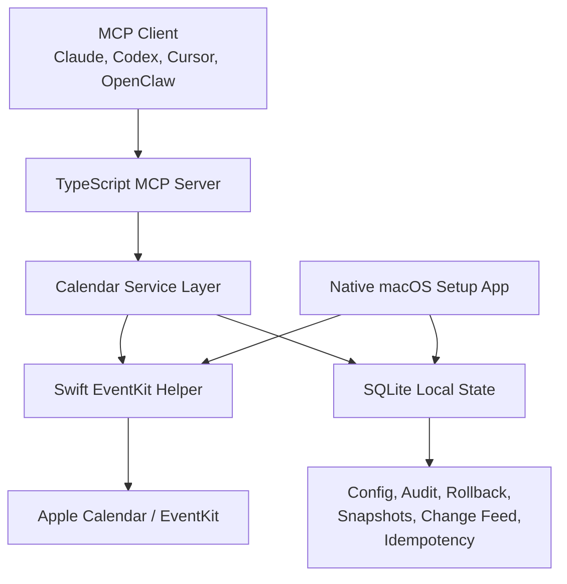

# Apple Calendar MCP

Apple Calendar MCP is a local-first Model Context Protocol server for safely connecting AI assistants to Apple Calendar on macOS.

It uses a TypeScript MCP server, a Swift EventKit helper, SQLite local state, and a native macOS setup app. Calendar data stays on the Mac, users choose which calendars are visible, and writes are guarded by permission modes, confirmation gates, duplicate checks, idempotency, rollback records, audit logs, and change feeds.

## Key Features

- Read Apple Calendar calendars, events, availability, and permissions through MCP tools.
- Create, update, reschedule, and delete events with preview-confirm safety by default.
- Enforce calendar allowlists server-side so blocked calendars remain hidden from agents.
- Track rollback records, audit records, compact snapshots, and token-efficient change feeds.
- Generate client configs for Claude Desktop, Codex, Cursor, OpenClaw, and generic MCP clients.
- Provide a native macOS setup wizard for Calendar permission, allowlists, permission mode, config generation, and verification.

## Architecture



The MCP server communicates over stdio. Logs are written to stderr or an optional local log file, never stdout, so MCP protocol traffic remains clean.

## Requirements

- macOS with Apple Calendar and EventKit access.
- Node.js `>=22.5`.
- Swift toolchain through Xcode Command Line Tools or Xcode.
- An MCP client such as Claude Desktop, Codex, Cursor, OpenClaw, or another stdio-compatible client.

## Install From Source

```sh
git clone <repo-url>
cd apple-calendar-mcp
npm install
npm run build
npm run helper:bundle
npm run helper:setup
```

The setup app walks through:

1. Calendar permission explanation and request.
2. Calendar allowlist selection.
3. Permission mode selection.
4. MCP client config generation.
5. Verification checks and test connection.

Generated local config is stored under:

```text
~/Library/Application Support/AppleCalendarMCP/
```

## MCP Client Setup

Generate validated client configs:

```sh
npm run client-configs:generate
```

Copy or merge the generated file from `.generated/client-configs/` into your client:

- Claude Desktop: `claude_desktop_config.json`
- Codex: append `codex.config.toml` to `~/.codex/config.toml`
- Cursor: copy or merge `cursor.mcp.json` into `~/.cursor/mcp.json` or a project `.cursor/mcp.json`
- OpenClaw: merge `openclaw.openclaw.json` into `~/.openclaw/openclaw.json`
- Generic MCP clients: use `generic-mcp-client.json`

Validate after copying:

```sh
npm run client-configs:validate
npm run client-configs:diagnose
```

The generated configs use an absolute Node executable, an absolute MCP server entrypoint, and an env block. Command and args are never combined into a shell string, which avoids failures with paths containing spaces.

## npx Startup Path

The publishable server package exposes this binary:

```sh
npx apple-calendar-mcp
```

For local development and release candidates, prefer:

```sh
npm run start:mcp
```

Before publishing to npm, publish the internal workspace packages in dependency order or use the release artifacts generated by `npm run release:package`.

## Security Model

Apple Calendar MCP is designed around defense in depth:

- macOS Calendar permission is required before EventKit access.
- Calendar allowlists restrict which calendars agents can see.
- Read-only, ask-before-write, trusted-write, and full-write modes control write risk.
- MVP writes require explicit confirmation or preview-confirm flow.
- Destructive and ambiguous operations return semantic errors instead of guessing.
- Recurring event writes require explicit scope.
- Calendar content is treated as untrusted input.
- Audit records, rollback records, idempotency keys, and change feeds are written locally.

See [docs/Security Specification.md](docs/Security%20Specification.md) for the full security model.

## Screenshots

Release screenshot placeholders:

- Setup wizard welcome and Calendar permission step.
- Calendar allowlist and permission mode step.
- Client configuration and verification step.
- Settings and diagnostics screen.

Capture signed-release screenshots before public distribution.

## Troubleshooting

- Calendar access denied: open System Settings > Privacy & Security > Calendars and enable the helper app.
- MCP server startup red in setup: run `npm run build` and verify `packages/mcp-server/dist/index.js` exists.
- Cursor or Codex cannot connect: regenerate configs with `npm run client-configs:generate` and ensure the copied config uses absolute paths.
- Client sees the server but no tools: restart the MCP client after config changes, then run `npm run client-configs:diagnose`.
- stdout/stderr separation fails: remove any stdout logging from the MCP server path; logs must go to stderr.
- Large reads fail: use narrower date ranges. The read service chunks large windows internally, but very large EventKit requests may still need retry.

## Development

```sh
npm install
npm run build
npm test
npm run helper:bundle
npm run helper:setup
```

Useful commands:

- `npm run typecheck`
- `npm run client-configs:generate`
- `npm run client-configs:validate`
- `npm run release:verify`
- `npm run release:package`

Read [docs/Development Guide.md](docs/Development%20Guide.md) before making security-sensitive changes.

## Repository Structure

```text
apps/macos-helper/        Swift EventKit bridge and native setup app
packages/mcp-server/      MCP stdio server and tool registration
packages/calendar-service/Business logic for reads, writes, rollback, snapshots
packages/sqlite-store/    Local SQLite persistence and migrations
packages/shared/          Shared schemas and typed contracts
scripts/                  Helper, config, diagnostics, and release scripts
tests/                    Phase-based safety and behavior tests
docs/                     Consolidated maintainer and release documentation
```

## Release

Create reproducible local release artifacts:

```sh
npm run release:package
```

Artifacts and checksums are written to:

```text
dist/release/
```

The GitHub release workflow runs the same package script on tag pushes matching `v*`.

## Roadmap

- Signed and notarized macOS release packaging.
- Public npm publication workflow after package namespace confirmation.
- More end-to-end client smoke tests across supported MCP clients.
- Expanded snapshot/change-feed pagination benchmarks.
- Better in-app screenshot capture and public documentation assets.

## Contributing

Security, reliability, user trust, MCP compliance, and maintainability come before convenience. Keep changes scoped, run the full test suite, and update docs when behavior changes. Do not bypass permission checks, allowlists, confirmation gates, rollback records, audit records, idempotency checks, or semantic errors.

Start with:

- [docs/Product Specification.md](docs/Product%20Specification.md)
- [docs/Technical Specification.md](docs/Technical%20Specification.md)
- [docs/Security Specification.md](docs/Security%20Specification.md)
- [docs/Development Guide.md](docs/Development%20Guide.md)
- [docs/Installation Guide.md](docs/Installation%20Guide.md)
- [docs/Release Checklist.md](docs/Release%20Checklist.md)
